# DevOps Lab — one small app, the whole DevOps toolchain

A hands-on project: a tiny Python API is tested, scanned, containerised, pushed to a registry and deployed to Kubernetes on a cloud VM, then monitored. You do it first on **AWS**, then repeat on **Azure** with the same code.

| Area | Tools |
|---|---|
| CI/CD (use all three, one at a time) | GitHub Actions · Jenkins · Azure Pipelines |
| Containers | Docker, ECR (AWS) / ACR (Azure) / Docker Hub |
| Code quality & security | SonarQube (code) · Trivy (image) |
| Infrastructure as Code | Terraform (AWS + Azure) |
| Configuration management | Ansible (installs Kubernetes, deploys the app) |
| Orchestration | Kubernetes (k3s, a lightweight single-node cluster) |
| Monitoring | Prometheus + Grafana |

## How it fits together

```mermaid
flowchart LR
  Dev[git push] --> CI["CI pipeline<br/>(GitHub Actions / Jenkins / Azure Pipelines)"]
  CI --> T[Unit tests + coverage]
  T --> S[SonarQube quality gate]
  S --> B[Docker build]
  B --> V[Trivy scan]
  V --> R[(ECR / ACR / Docker Hub)]
  R --> A[Ansible deploy over SSH]
  A --> K["k3s Kubernetes on a VM<br/>(created by Terraform)"]
  K --> App[devops-lab pods :30080]
  K --> P[Prometheus :30090] --> G[Grafana :30030]
  App -- /metrics --> P
```



**Design choice:** the pipeline YAML files are deliberately thin. The real work lives in `scripts/ci/*.sh` (test, sonar, build, scan, push, deploy). The three CI tools just call the same scripts. That is why moving from GitHub Actions to Jenkins to Azure Pipelines, or from AWS to Azure, only changes a few settings and not the logic.

## Repository layout

```
app/                 Flask API (+ Prometheus metrics), tests, Dockerfile
scripts/ci/          the pipeline logic: test, sonar, build, scan, push, deploy
terraform/aws        VPC, EC2 VM, Elastic IP, ECR
terraform/azure      VNet, VM, public IP, ACR
ansible/             site.yml (install k3s) · deploy.yml (app) · monitoring.yml
k8s/app              Namespace, Deployment, Service, HorizontalPodAutoscaler
k8s/monitoring       Prometheus + Grafana manifests
monitoring/          alert rules, Grafana dashboard, local-compose configs
tools/               Jenkins + SonarQube (docker compose)
.github/workflows/   GitHub Actions pipeline
Jenkinsfile          Jenkins pipeline
azure-pipelines.yml  Azure Pipelines pipeline
docker-compose.yml   run app + Prometheus + Grafana on your laptop
```

## Prerequisites

Docker (with Compose), Git, Python 3.12, Terraform ≥ 1.5, AWS CLI, Azure CLI (for the Azure phase), an SSH key (`ssh-keygen -t rsa -b 4096` if you don't have `~/.ssh/id_rsa`), a GitHub account, an AWS account and an Azure account + Azure DevOps organization.

> **Cost warning.** Terraform creates a paid VM (about 2 vCPU / 4 GB), a public IP and a registry. Expect a few US cents per hour. **Run `terraform destroy` when you stop for the day.** Set a budget alert in both clouds first.

---

## Phase 1 — Run everything locally (30 min)

```bash
make test            # unit tests + coverage (creates .venv)
make up              # app + Prometheus + Grafana in Docker
make load            # generate traffic for 2 minutes
```

* App: http://localhost:8000 (`/health`, `/api/tasks`, `/api/slow`, `/api/error`, `/metrics`)
* Prometheus: http://localhost:9090 (try `rate(http_requests_total[1m])`, open *Alerts*)
* Grafana: http://localhost:3000 (admin/admin) → dashboard **DevOps Lab - Application**

```bash
curl -X POST localhost:8000/api/tasks -H 'Content-Type: application/json' -d '{"title":"learn devops"}'
curl localhost:8000/api/tasks
```

Stop with `make down`.

## Phase 2 — SonarQube and Jenkins locally (30 min)

```bash
sudo sysctl -w vm.max_map_count=524288    # Linux only; Docker Desktop users can skip
make tools
```

1. SonarQube http://localhost:9000 — log in `admin`/`admin`, set a new password. *My Account → Security → generate a token* (type: User or Project analysis token). Save it.
2. Quick scan from your laptop (needs `make test` run first, so `coverage.xml` exists):
   ```bash
   SONAR_HOST_URL=http://localhost:9000 SONAR_TOKEN=<token> scripts/ci/sonar.sh
   ```
   Open the project `devops-lab` in SonarQube and look at coverage, smells and the quality gate.
3. Jenkins http://localhost:8080 — unlock with `docker compose -f tools/docker-compose.yml exec jenkins cat /var/jenkins_home/secrets/initialAdminPassword`, install suggested plugins, create an admin user. (Jenkins is used in Phase 6.)

Trivy by hand: `scripts/ci/build.sh && scripts/ci/scan.sh`. Open `reports/trivy.json`.

## Phase 3 — Push the project to GitHub

```bash
git init -b main && git add . && git commit -m "Initial commit"
# create an empty repo on GitHub, then:
git remote add origin https://github.com/<you>/devops-lab.git && git push -u origin main
```
The first push runs only tests and the Trivy gate, because the cloud secrets are not configured yet and `ENABLE_CD` is not set. That's expected.

## Phase 4 — AWS: build the infrastructure with Terraform (20 min)

```bash
aws configure                      # an IAM user with permissions to create EC2/VPC/ECR
cd terraform/aws
cp terraform.tfvars.example terraform.tfvars   # set admin_cidr to <your public IP>/32  (curl ifconfig.me)
terraform init
terraform plan
terraform apply
terraform output
```
Note the outputs: `public_ip` and `ecr_repository_url`. Read the plan before typing `yes`; it's the main habit Terraform teaches you.

## Phase 5 — AWS: Kubernetes with Ansible (15 min)

Install Ansible (`pip install ansible-core`), then:

```bash
cd ../../ansible
cp inventory.ini.example inventory.ini        # put the public_ip in it
ansible-playbook -i inventory.ini site.yml    # installs k3s (single-node Kubernetes)
```
Check it from the VM: `ssh ubuntu@<ip>` then `kubectl get nodes` (k3s makes the kubeconfig readable; if `kubectl` can't find it use `export KUBECONFIG=/etc/rancher/k3s/k3s.yaml`).

Install monitoring on the cluster:
```bash
GRAFANA_ADMIN_PASSWORD='choose-a-password' ansible-playbook -i inventory.ini monitoring.yml
```
Grafana is then at `http://<ip>:30030`, Prometheus at `http://<ip>:30090` (only reachable from your `admin_cidr`).

## Phase 6 — AWS: the pipelines (do them one by one)

Create an AWS access key for CI (IAM user with ECR push permissions, e.g. `AmazonEC2ContainerRegistryPowerUser`). Because you are learning, a key is the simplest way to start; once it works, try replacing it with GitHub OIDC as an exercise.

### 6a. GitHub Actions

Repo → Settings → *Secrets and variables → Actions*

| Type | Name | Value |
|---|---|---|
| Secret | `AWS_ACCESS_KEY_ID`, `AWS_SECRET_ACCESS_KEY` | the CI IAM user |
| Secret | `SSH_PRIVATE_KEY` | contents of `~/.ssh/id_rsa` (the private key matching the Terraform public key) |
| Variable | `DEPLOY_HOST` | `public_ip` from Terraform |
| Variable | `AWS_REGION` | e.g. `ap-south-1` |
| Variable | `ENABLE_CD` | `true` (so pushes to main push and deploy) |
| Secret / Variable | `SONAR_TOKEN` / `SONAR_HOST_URL` | optional, see note below |

Then Actions → *ci-cd* → *Run workflow* (cloud = aws), or push a commit. Open `http://<public_ip>:30080/health`.

> **SonarQube from GitHub-hosted runners:** your laptop's SonarQube is not reachable from the internet, so the scan is skipped unless you set `SONAR_HOST_URL`/`SONAR_TOKEN`. Options: use **SonarCloud** (free for public repos; set host URL `https://sonarcloud.io` and add `sonar.organization` to `sonar-project.properties`), or host SonarQube on a cloud VM. Jenkins (below) reaches your local SonarQube directly.
> Also add a **required reviewer** to the `production` environment (Settings → Environments) to practise a manual approval gate.

### 6b. Jenkins (the local one from Phase 2)

1. *Manage Jenkins → Credentials → Global*: create `aws-creds` (username + password = access key id + secret), `sonar-token` (secret text), `deploy-ssh-key` (SSH username `ubuntu` + your private key). Also create `acr-creds` and `dockerhub-creds` now or later.
2. New Item → *Pipeline* → *Pipeline script from SCM* → Git → your repo URL (add GitHub credentials if private) → branch `main` → script path `Jenkinsfile`.
3. *Build with Parameters*: `CLOUD=aws`, `DEPLOY_HOST=<public_ip>`.

Jenkins talks to SonarQube at `http://sonarqube:9000` (the compose network), so the quality gate works out of the box.

### 6c. Azure Pipelines (deploying to AWS)

1. Azure DevOps → new project → *Pipelines → New pipeline* → GitHub (or Azure Repos) → *Existing YAML* → `azure-pipelines.yml`.
2. Create the variable group `devops-lab-secrets`, the secure file `deploy_key.pem` and the environment `devops-lab-prod` exactly as described at the top of `azure-pipelines.yml`.
3. Run the pipeline with `cloud = aws`.

**Checkpoint:** each pipeline should show Test → (Sonar) → Build → Trivy → Push → Deploy, and `http://<public_ip>:30080/api/tasks` should answer. After each deploy check `kubectl -n devops-lab get pods` and look at the `app_info` panel in Grafana, which shows the running version (git SHA).

## Phase 7 — Observe it

```bash
scripts/load.sh http://<public_ip>:30080 180
```
Watch Grafana: requests/s, p95 latency (`/api/slow`), error rate (`/api/error`). Trigger the **HighErrorRate** alert by hitting `/api/error` repeatedly, and see it go *Pending → Firing* in Prometheus → Alerts. (Alerts are visible in the UI only; wiring Alertmanager is an exercise.)

## Phase 8 — Repeat on Azure

```bash
az login && az account show --query id -o tsv      # your subscription id
cd terraform/azure
cp terraform.tfvars.example terraform.tfvars        # subscription_id, admin_cidr
terraform init && terraform apply
terraform output
terraform output -raw acr_admin_password            # needed for the pipelines
```
Then the same Ansible commands as Phases 5 (new VM IP in `inventory.ini`; **delete the old AWS entry**), and in the pipelines switch the target:

| Setting | AWS | Azure |
|---|---|---|
| Pipeline parameter `CLOUD` | `aws` | `azure` |
| Registry | ECR | ACR (`ACR_LOGIN_SERVER`, `ACR_USERNAME`, `ACR_PASSWORD` from Terraform outputs) |
| `DEPLOY_HOST` | AWS Elastic IP | Azure public IP |
| Everything else | identical | identical |

For Docker Hub: `CLOUD=dockerhub`, create a **public** repo `devops-lab`, and set `DOCKERHUB_USERNAME` / `DOCKERHUB_TOKEN`.

## Phase 9 — Clean up

```bash
cd terraform/aws   && terraform destroy
cd ../azure        && terraform destroy
docker compose down -v ; (cd tools && docker compose down -v)
```
Delete the CI IAM access key when you're finished.

---

## Troubleshooting

| Symptom | Likely cause / fix |
|---|---|
| Trivy gate fails | Open `reports/trivy.json`. Fix by bumping the base image or the dependency version; this is the intended learning loop. |
| `ImagePullBackOff` | `kubectl -n devops-lab describe pod`. Wrong registry/tag, expired ECR token (rerun the deploy; tokens last 12 h) or the Docker Hub repo is private. |
| Ansible `UNREACHABLE` | Wrong IP/user/key, or `ssh_cidr` doesn't include the machine you deploy from. |
| Can't open Grafana/Prometheus | Your public IP changed; update `admin_cidr` and `terraform apply`. |
| `terraform apply` fails on VM size (Azure) | Pick another `vm_size` or `location`: `az vm list-skus -l <region> --size Standard_B2 -o table`. |
| SonarQube won't start | `vm.max_map_count` too low (see Phase 2). |
| Pods show different task lists | Expected: tasks live in memory, and there are 2 replicas. A good motivation for the exercises below. |

## Honest limits of this lab (and exercises to level up)

This is a learning setup. Known simplifications: single node (no HA), plain HTTP, in-memory data, CI uses long-lived keys, Azure ACR admin user is enabled, SSH is open to the internet by default, SonarQube uses its embedded database, Grafana/Prometheus data is not persisted.

1. Replace in-memory tasks with PostgreSQL (Kubernetes StatefulSet or RDS/Azure Database) so replicas agree.
2. Move Terraform state to S3 / Azure Storage with locking.
3. Replace the AWS access key with GitHub OIDC; replace the ACR admin user with a service principal.
4. Put an Ingress + TLS (cert-manager) in front of the app.
5. Add Alertmanager and send alerts to email/Slack; add node-exporter and kube-state-metrics.
6. Add a rollback step: `kubectl rollout undo` when the post-deploy smoke test fails.
7. Swap the single VM for EKS / AKS using Terraform and keep the same manifests.
8. Sign images (cosign) and generate an SBOM with Trivy.
